# NoteTrail

NoteTrail 是一款为 Obsidian 知识库设计的 macOS 桌面应用。不记得一件事写在哪篇笔记里时，直接提问，点开回答旁的引用就能核对原句。遇到值得留的文件或网页，也能在同一个窗口收进库里。

**运行环境：macOS 26.6，Apple Silicon（arm64）。** 首次从源码安装需要联网，无需预装 Node.js 或 Python。

**[从源码安装](desktop/README.md#从源码安装)** · [桌面使用指南](desktop/README.md#打开与使用) · [常见问题](TROUBLESHOOTING.md)

## 第一次提问

1. 在桌面左下角打开**设置**，选择你的 Obsidian 知识库文件夹，配置云端大模型并填入自己的 API 密钥。
2. 把源码里的[示例交接记录](tests/fixtures/public/t00/inputs/chat/handover.md)拖入对话，点击**存入知识库**。文件显示“可用于问答”后，问：**蓝色工具箱放在哪儿？最迟什么时候交接？**
3. 点击回答里的引用。右侧原文的两条记录分别写着“北柜第二层”和“周五 15:00 前”。再问红色工具箱的位置：同一份记录只说位置没有确认，不能照搬蓝色工具箱的答案。

## 日常使用

- **收资料。** 拖入文件、粘贴文字或收藏网页。原件保存在知识库；扫描 PDF 可以另附可读文字，旧版 `.doc` 请先转成 `.docx`。回答不会自动写成笔记，只有选中并确认的段落才会存入库中。
- **切换项目。** 在侧栏切换知识库，回到某个库时，它的聊天、输入草稿和未发送的附件也会回来。
- **接着上次做。** 按关键词找回旧对话，用“续接思路”回看上次的决定和停点；事情做完后，用“结果复盘”对照当时的判断与实际结果。
- **跟进有变化的答案。** 对某条回答开启“持续关注”。应用运行且该库处于选中状态时，相关资料有变化就会触发复核；新旧答案和引用可以对照查看。

## 问答流程

问自己的项目时，NoteTrail 优先查所选知识库。笔记引用可以打开对应原句；网页来源可以查看链接和摘录。模型凭通用知识作答时，不会把它标成笔记里的结论。

[查看流程图源码](docs/answer-flow.mmd)

## 隐私、费用与备份

**资料存放在本机，问答使用云模型。** 原件、聊天记录和你主动保存的记忆存放在 Mac 上，API 密钥保存在 macOS 钥匙串。提问时，你配置的云端大模型会收到问题、所需资料片段、相关对话和记忆。配置搜索服务后，应用可按需自动发送搜索词，不会逐次询问。连接测试、问答、关注复核和搜索都可能收费；应用不设金额上限。[数据与联网说明](WEB_SEARCH.md)

换机或升级前，请分别备份知识库、应用数据和桌面配置。桌面配置还包含其他知识库的应用数据、草稿和待发送的附件；只备份第一个库的应用数据并不够。[备份与恢复](TROUBLESHOOTING.md)

## 从旧工具链迁移

此前用 npm 或 pnpm 安装过 NoteTrail 的用户，请按[迁移步骤](desktop/README.md#从旧工具链迁移)备份并恢复到新目录，不要覆盖原安装。

[贡献指南](CONTRIBUTING.md) · [安全问题报告说明](SECURITY.md) · [MIT 许可证](LICENSE) · [第三方许可](THIRD_PARTY_NOTICES.md)
